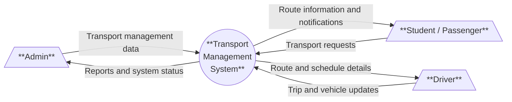
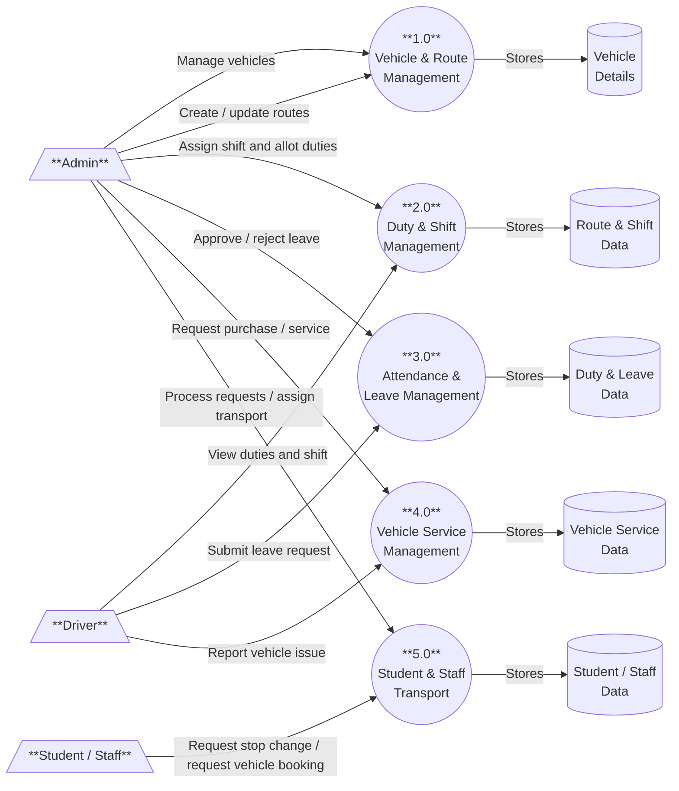
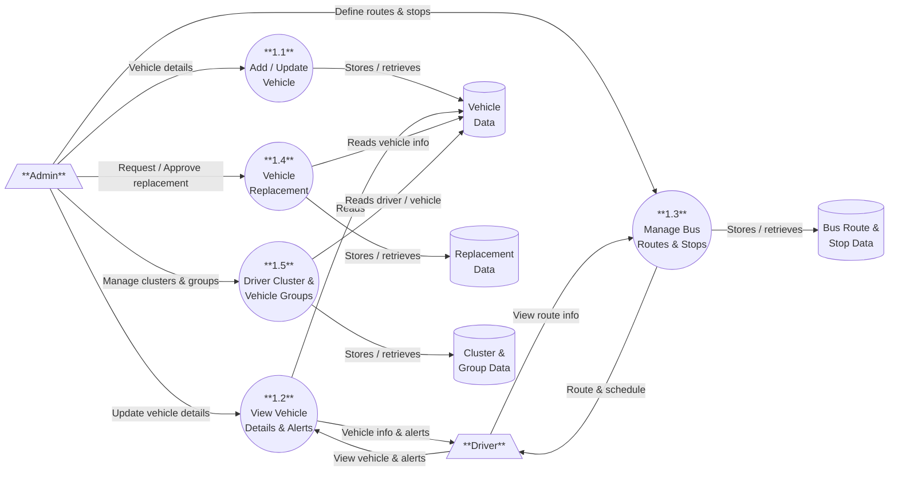
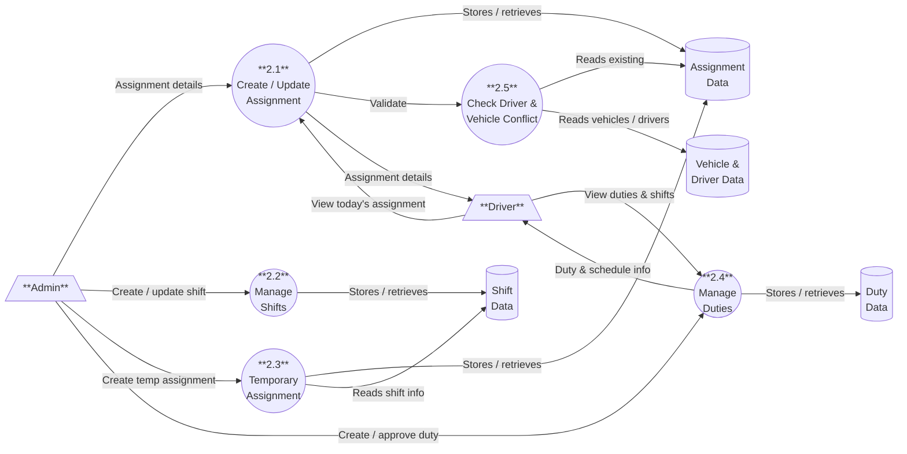
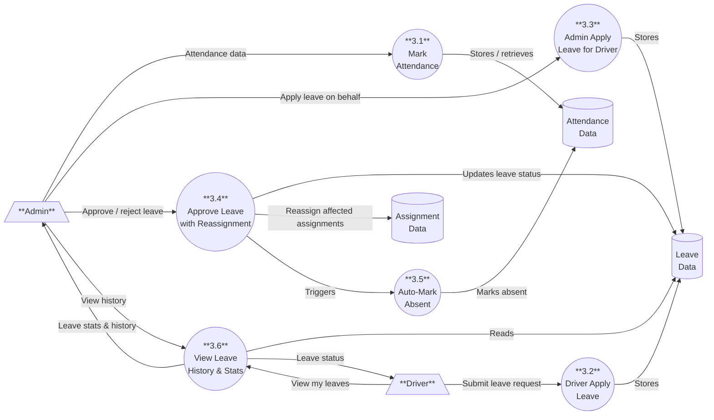
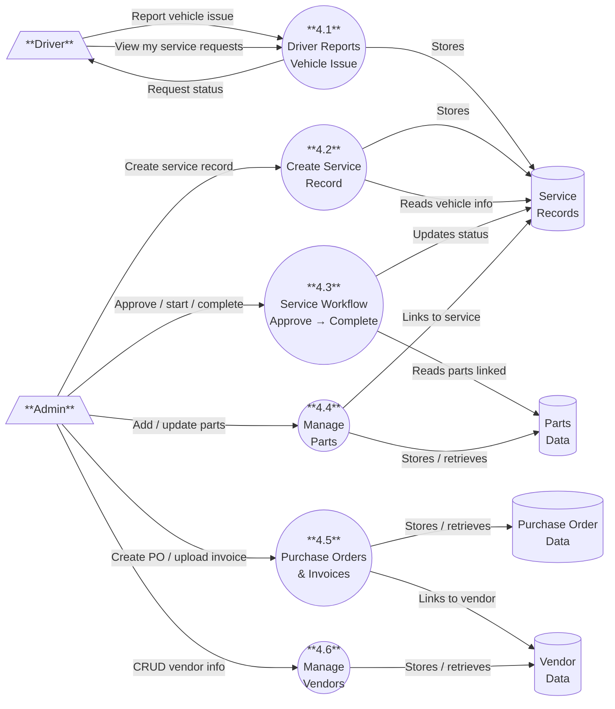
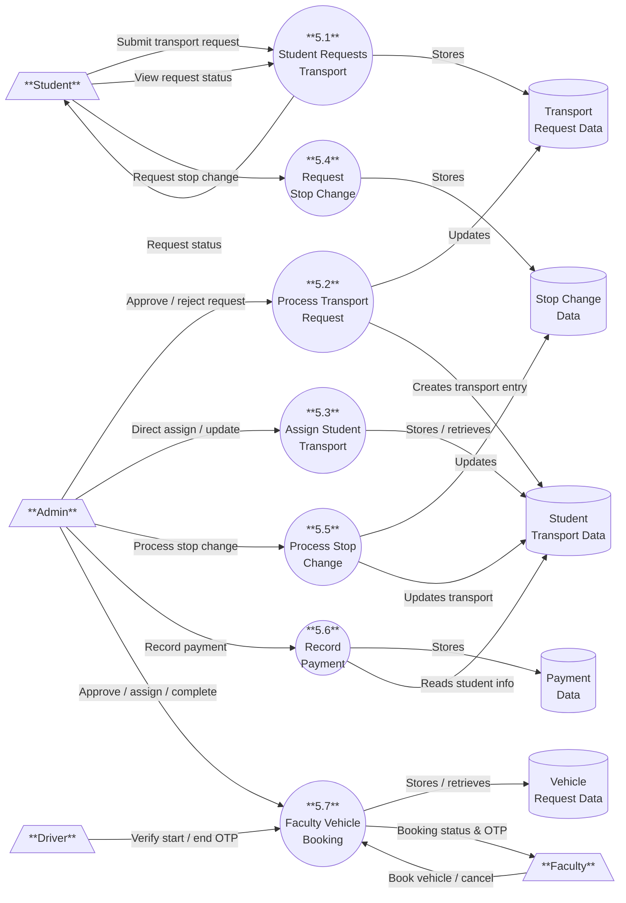

# DATAFLOW DIAGRAMS — Transport Management System

---

## DATAFLOW DIAGRAM LEVEL-0

---

## DATAFLOW DIAGRAM LEVEL-1

---

## DATAFLOW DIAGRAM LEVEL-2

### 1.0 Vehicle & Route Management

---

### 2.0 Duty & Shift Management

---

### 3.0 Attendance & Leave Management

---

### 4.0 Vehicle Service Management

---

### 5.0 Student & Staff Transport

